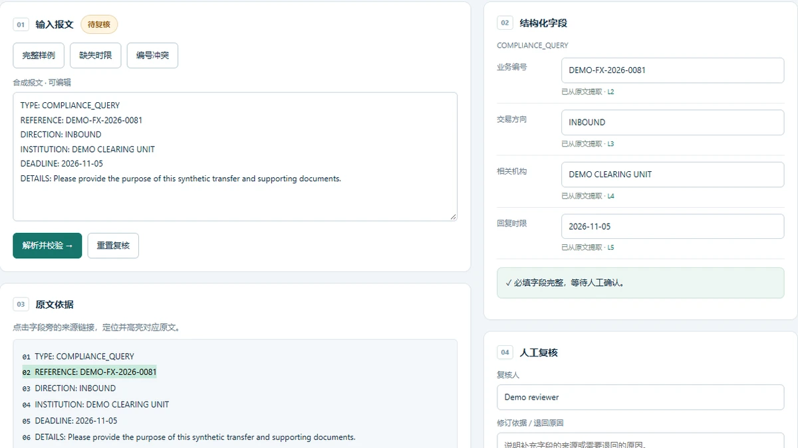

# Message Review Workflow · 报文解析与人工复核

按报文类型提取字段，定位原文行，检查缺失、冲突与格式错误。人工修订和原始抽取分别保留，复核结论可导出。

[在线 Demo](https://gangyang96.github.io/message-review-workflow/?lang=zh) · [核心源码](src/core.js) · [运行与设计说明](docs/architecture.md) · [测试](tests/)



## 运行

浏览器直接打开根目录的 `index.html` 即可，支持中文和英文，无需安装依赖、模型或 API Key。也可在仓库根目录运行：

```sh
python -m http.server 8080 --bind 127.0.0.1
```

浏览器访问 http://127.0.0.1:8080/ 。命令行与测试要求 Node.js 22+，仅使用标准库：

```sh
node scripts/review.cjs --input examples/missing.txt --corrections examples/corrections.json --reviewer "Demo reviewer" --notes "Synthetic follow-up confirms deadline" --decision approve
node --test tests/*.test.cjs
```

缺失时限样例不能直接确认；补充 DEADLINE 并填写依据后可确认。原文仍保留缺失状态，修订值单独输出。

CLI 默认输出 JSON 到终端；添加 `--output outputs/result.json` 保存文件。输出文件已存在时会报错，需使用新文件名。所有命令从仓库根目录运行。

## 仓库内容

| 路径 | 内容 |
| --- | --- |
| `src/core.js` | 浏览器和 Node 共用的计算/校验逻辑 |
| `web/` | 界面交互、中文/英文文案及样式 |
| `scripts/` | 可重复执行的命令行入口 |
| `examples/` | 合成输入与对应 JSON 输出 |
| `tests/` | 核心规则、边界输入及命令行检查 |
| `docs/` | 实现说明、截图及验证范围 |

## 实现范围

源于 HiAgent 报文处理经历的独立公开演示，支持所示键值格式及两个报文类型；不是通用 SWIFT 解析器，也没有连接 HiAgent、鉴权服务或持久化审计数据库。

本仓库在 2026-10-29 从个人主页中的可运行 Demo 整理发布，代码和示例使用 AI 辅助开发并经过本地验证。它是根据项目介绍重新实现的公开原型，不是原单位历史系统的源代码。原始工程经历与公开原型的实现范围分别说明。

## 验证

自动化检查覆盖计算结果、异常输入、证据引用和可重复执行。具体断言与测试名称见 `tests/`；浏览器界面已在桌面与手机尺寸检查。GitHub Actions 在提交后运行相同 Node 测试，见 Actions 页。

## 来源与许可

代码由本项目独立实现。仓库结构参考 [GuHang2011/frontend-data-lab](https://github.com/GuHang2011/frontend-data-lab) 与 [GuHang2011/counselor-workflow-showcase](https://github.com/GuHang2011/counselor-workflow-showcase) 的源码、样例、测试和说明组织方式，没有复制其代码或项目经历。详见 [SOURCE.md](SOURCE.md)。本仓库代码和合成素材采用 MIT 许可。

## English

Schema-based message extraction, source citations and human-review decisions with synthetic fixtures. Open `index.html` directly, or serve this folder with Python. The browser and CLI use the same `src/core.js`. This is an independent, AI-assisted public prototype using synthetic fixtures, published in October 2026; it is not the original employer system, a model benchmark, or a production service.
